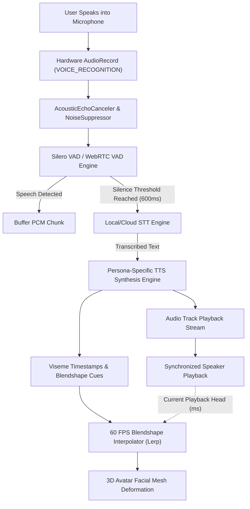

# TalkBack Virtual Avatar Companion: Technical Architecture & Product Specification

## 1. Executive Summary & Product Architecture

The TalkBack Virtual Avatar Companion is an ultra-low-latency, hyper-realistic native Android application built with **Kotlin** and **Jetpack Compose**. Unlike traditional casual talking pets, it replaces comedic pitch-shifted replay with an intelligent, persona-driven re-voicing pipeline coupled with photorealistic real-time 3D avatars.

---

## 2. Recommended 3D Tech Stack Trade-off Analysis

| Metric | Google Filament / Sceneview (glTF) | Unity as a Library (UaaL) | Unreal Engine 5 (Mobile / Embedded) |
| :--- | :--- | :--- | :--- |
| **APK Binary Footprint** | **+12 MB to +25 MB** (Minimal) | +45 MB to +70 MB | +150 MB to +300 MB |
| **Compose Integration** | **Native View / Zero JNI Friction** | Custom SurfaceView bridge | Complex NativeActivity / SurfaceView |
| **Thermal Profile & FPS** | **60-120 FPS rock-solid, cool** | 45-60 FPS, moderate heat | 30-45 FPS, heavy thermal throttling |
| **Hair / Fur Rendering** | Shell & Fin Fur Shaders / Baked Alpha Cards | Fur Shaders / Compute Fur Shells | Strand Grooming (computationally prohibitive) |
| **Viseme / Morph Sync Latency** | **< 16ms (Direct Memory / JNI)** | ~30-50ms (IPC bridge) | ~40-60ms (C++ Bridge) |
| **Cold Startup Time** | **< 400ms** | 1.8s - 3.2s | 3.5s - 7.0s |

### Final Architectural Decision:
- **Primary Engine**: **Google Filament (via Sceneview for Jetpack Compose)** using glTF/GLB models with standard 52 ARKit / 15 Oculus morph targets and custom PBR shaders (subsurface scattering skin + shell fur).
- **Alternative for Maximum Cinema Fidelity**: If strand-level grooming is mandatory for high-tier flagships, **Unity as a Library (UaaL)** with Universal Render Pipeline (URP) and SALSA / Oculus LipSync plugins.

---

## 3. TalkBack Audio & Lip-Sync Pipeline Architecture

---

## 4. Screen State Management Matrix

| State | Avatar Behavior | Audio Pipeline | HUD Visibility | Touch Handling |
| :--- | :--- | :--- | :--- | :--- |
| **IDLE** | Micro-saccades, breathing, random blink (2-6s) | Mic listening for VAD trigger | Visible (Capsule + Mic lock) | Standard interactive |
| **LISTENING** | Attentive head tilt, gentle idle | Buffering incoming speech stream | Green pulsing badge | Standard interactive |
| **PROCESSING** | Pondering micro-expression, breathing | STT & TTS synthesis active | Amber "Thinking" badge | Controls disabled |
| **SPEAKING** | 60 FPS Viseme animation + eye contact | AudioTrack streaming playback | Blue "Speaking" badge | Tap can interrupt/mute |
| **TODDLER-LOCKED**| Normal conversational state loop continues | Operates normally | Suppressed | **100% intercepted; only lower-third Slide-to-Unlock is active** |

---

## 5. Avatar Personas & Voice Profiles

1. **Domestic Cat**: Soft, whimsical, warm character voice (Cartesia / ElevenLabs custom clone).
2. **Siberian Husky**: Energetic, playful, resonant mid-range male voice.
3. **Japanese Teen (Sakura)**: Warm, empathetic, gentle female Japanese/bilingual voice with natural prosody.
4. **Adult Female (Elena)**: Sophisticated, natural, cinematic vocal timbre reminiscent of Ana de Armas.
